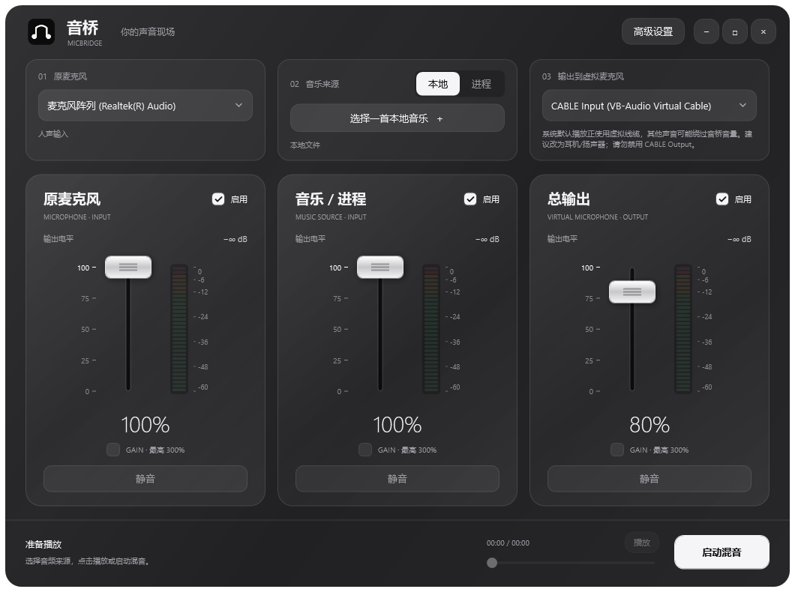

# MicBridge 音桥

Windows 桌面混音工具。把本地音乐、网易云等程序声音和原麦克风混合，发送到虚拟音频线缆，让游戏把混音当作麦克风输入。

**v0.4.7，约 2.3 MB 的单 EXE，支持声卡立体声混音与内置虚拟驱动。** C# / WPF / NAudio，默认使用 Windows 自带的 .NET Framework 4.8，另保留 .NET 8 构建目标；项目代码 MIT 开源。

[下载 v0.4.7 单 EXE](https://github.com/sofuerus8429/icBridge/releases/download/v0.4.7/MicBridge.exe) · [下载完整包](https://github.com/sofuerus8429/icBridge/releases/download/v0.4.7/MicBridge-0.4.7-win-x64.zip) · [最新发行版](https://github.com/sofuerus8429/icBridge/releases/latest)

> **请勿禁用 CABLE Output，它就是游戏所需的虚拟麦克风；CABLE Input 也需保持启用。** 首次使用请按[新手配置说明](docs/configuration.md)连接设备，内含网易云选择、禁用恢复及工作原理图。



## 已实现

- 声卡自带立体声混音时，可免装额外虚拟驱动。高级设置检测现有录音端，实测后自动选择可录回的播放端；不创建新的系统麦克风。未提供此端点的声卡仍使用虚拟线缆。
- 声卡模式首次播放自动验证实际录回路径，本次运行内缓存成功结果；更换端口或设备变化后重新验证。检测可取消，关闭软件会停止测试音；Windows 端点静音或音量为零时给出恢复提示。
- 使用 Windows 端点通知自动更新设备状态，无设备变化时不轮询；必要录音端被禁用或断开时停止转发并提示恢复。
- 系统默认播放设为虚拟线缆时提醒恢复耳机/扬声器，避免其他程序直出绕过音桥推子；进程采集连接期间关闭应用会取消等待并释放已打开的路由。
- 进程采集线程使用 Windows Audio 多媒体调度，停止时在同一线程释放；服务不可用时沿用普通采集，不增加运行线程或修改系统计时器与调度注册表。
- 空通道快速补静音，稳定增益缓存系数，关闭的麦克风处理直接旁路。保持静音时音源继续推进、输入电平检测和立体声渐变。
- 峰值保护在正常音量下直接保留波形，减少限幅计算；大音量继续使用双声道联动保护与 100 ms 恢复，NaN / 无穷值清零。
- 单声道音源先重采样再复制为双声道，避免对相同波形重复过滤；保持 48 kHz 立体声混音与现有波形。
- 关闭原麦克风通道时释放实际 WASAPI 采集，重新启用时自动接回，减少只播放音乐时的后台工作。
- 内置完整官方 VB-CABLE Pack45 驱动包；首次打开时检查虚拟播放和录音设备，缺少驱动时提供安装入口。官方安装器需要 Windows 管理员批准，安装后按提示重启。已安装但禁用时提供恢复提示，避免重复安装。
- 默认输出仅列出普通双声道 CABLE Input；高级设置可显示多通道端口和普通扬声器。保持 CABLE Input / CABLE Output 启用，CABLE Output 就是游戏所需的虚拟麦克风。
- 空闲时停止电平采样，播放时每 60 ms 更新，最小化后每 250 ms 更新。音频采集仍以 WASAPI 事件驱动；灯柱画刷缓存复用，仅灯段变化时重绘。
- 配套卸载入口及高级设置中的“卸载与清理”，支持启动官方驱动维护工具和可选清除设置。
- 配置使用独立暂存文件和跨实例短时互斥保存，避免多个窗口同时保存时冲突；加载与保存结束即释放锁，不增加常驻线程。

- 黑白玻璃调音台：上方依次选择原麦克风、本地/进程音乐来源和虚拟输出；下方三路竖向推子、细分段拾音灯与静音按钮。拾音灯参考 SSL Live 调音台，从下往上随实际电平跳动，采用绿、黄、红提示。Windows 11 支持系统 Acrylic 背景。
- 本地音乐播放列表：添加、拖放、移除、播放/暂停、停止、上一首/下一首、进度跳转、单曲循环和顺序播放。
- 默认列出全部进程，包含系统、其他会话和后台进程，支持搜索进程名、窗口标题和 PID；自动采集选中进程及其子进程，适用于网易云、浏览器等。音桥自身及系统空闲进程保留显示但不可采集。
- 提供整个播放设备的兼容采集模式；选择和启动时检查进程启动时间，拒绝已退出或重启后的旧选择，避免误用旧 PID。
- 原麦克风叠加；正常推子 0–100%，每路开启 GAIN 后最高 300%（三倍振幅）。精细 −24 至 +24 dB 增益、交叉混音和监听放在高级设置。
- 独立总输出音量、一键全部静音、实时电平、立体声峰值保护。
- 可选耳机监听、独立监听音量、设备刷新、输出缓冲调整和设置自动保存。
- 可选麦克风 80 Hz 高通与静音门，默认关闭；静音门抑制说话间隙的底噪。
- 48 kHz / 32-bit float / 立体声内部混音；自动统一采样率和声道，实际格式在高级设置展示。

## 先连接虚拟麦克风

**本项目包含播放器、混音软件与第三方 VB-CABLE 安装包。** 如果声卡已有“立体声混音”，可以使用下方免额外驱动方式；否则需要安装虚拟驱动以提供游戏可选择的录音设备。内置安装入口省去单独下载。也兼容已安装的 Voicemeeter 等线缆。

### 使用现有声卡，无需安装额外驱动

1. 高级设置 → 设备与连接，勾选“使用声卡立体声混音”。
2. 如果显示禁用，点击“打开录音设备”，右键显示已禁用的设备，启用“立体声混音”。设备变化会自动刷新，也可手动刷新。
3. 游戏输入选择同一个“立体声混音”。首次播放会短暂播放低音量测试音，从实际录音端验证输出，必要时切到可录回的端口；不保存录音。高级设置可手动“检测并选择可用输出”或取消检测。
4. 返回主界面选择音源、播放和调节推子。

此模式依赖已有声卡驱动，不适用于所有声卡；扬声器和耳机可能只有一个端口可录回。它会采集这块声卡上的所有播放声音，包含游戏声和音乐程序直出。需要独立调音时，将游戏及音乐程序的播放移到另一块声卡/USB 耳机；不要开启 Windows“侦听此设备”。无法隔离其他声音时，使用虚拟线缆更合适。[微软的硬件回环说明](https://learn.microsoft.com/en-us/windows/win32/coreaudio/loopback-recording)。

### 使用虚拟线缆

以 [VB-CABLE](https://vb-audio.com/Cable/) 为例：

1. 双击 MicBridge.exe，首次使用若缺少虚拟设备会显示安装界面。点击“安装虚拟麦克风”，批准 Windows 管理员权限请求，在官方安装器中点击 Install Driver，按提示重启电脑。
2. MicBridge 主界面右上输出选择 **CABLE Input**，左上选择原麦克风；高级设置可刷新设备。
3. 游戏的麦克风/输入设备选择 **CABLE Output**。
   **请勿禁用 CABLE Output。** 如果找不到，在 Windows 声音设置 → 所有声音设备 → 输入设备中允许它，再刷新音桥。Windows 10 可在 `mmsys.cpl` 的“录制”页显示禁用设备并启用。
4. 主界面选择本地文件或进程，点击“播放”或“启动混音”，用三个竖向推子调整人声、音乐和最终输出。

```text
本地文件 ── 音量 / 增益 ──┐
程序声音 ── 音量 / 增益 ──┼── 总音量 → 峰值保护 → CABLE Input → CABLE Output → 游戏麦克风
原麦克风 ── 音量 / 增益 ──┘                   └→ 耳机监听（可选）
```

没有安装虚拟驱动时，可以在高级设置勾选“显示其他输出设备”后选择普通播放设备试听；普通扬声器不会变成游戏麦克风。VB-CABLE 是第三方 Donationware，不属于本项目的 MIT 授权，欢迎通过 [VB-Audio 官网](https://vb-audio.com/Cable/) 捐赠或购买许可支持作者。原始驱动包完整保留，分发条件见 [官方许可](https://vb-audio.com/Services/licensing.htm) 和 `assets/drivers/vb-cable/NOTICE.md`。

## 运行

单文件版位于 `dist/0.4.7/MicBridge.exe`，约 2.3 MB，比 v0.2.2 减少约 97%。只复制这个 EXE 即可运行，全部运行所需依赖和完整驱动包都在 EXE 内，无需旁边的 DLL，也不会释放 .NET 运行时到缓存。它使用系统自带的 .NET Framework 4.8；[Windows 11 和 Windows 10 1903 及以上已包含该框架](https://learn.microsoft.com/en-us/dotnet/framework/install/versions-and-dependencies)。旧系统需先安装该框架；开发者可选择 `publish-single-file.ps1 -BundledRuntime` 构建较大的 .NET 8 自包含版本。

驱动只需安装一次，需要管理员批准并按提示重启。更新时先关闭旧版，再打开新版。可选 `Uninstall-MicBridge.exe` 放在主 EXE 旁打开卸载窗口；也可直接从高级设置打开，或运行 `MicBridge.exe --uninstall`。卸载驱动后按官方提示重启。软件本体是便携文件，退出后删除 EXE；清除设置不会删除音乐文件。

源码运行需要 Windows 和 [.NET SDK 8 或以上](https://dotnet.microsoft.com/download)。

```powershell
dotnet restore MicBridge.sln --locked-mode
dotnet run --project src/MicBridge.App -f net48
```

也可以双击根目录的 `Run-MicBridge.cmd`，优先打开已发布版本，没有发布版本则从源码运行。

推荐 Windows 11。Windows 10 22H2 可以使用本地文件、麦克风和播放设备兼容采集。**指定程序采集要求 Windows build 20348 或以上**，普通 Windows 10 22H2 的 build 19045 不具备此接口。

常见音频格式：WAV、MP3、FLAC、AAC、M4A、WMA、AIFF。除内置解码格式外，可播放性取决于 Windows Media Foundation 的解码器；加密的网易云 NCM 文件应在网易云程序中播放，再采集程序声音。

## 使用提示

- 程序启动或重启后，停止混音、刷新程序列表，再选择新的 PID。
- 主界面选“进程”，点击来源选择按钮，搜索 `cloudmusic`，选中有窗口的网易云主进程，点击“用作声音源”，再点“启动混音”。
- 后台进程也可以选。可勾选“仅显示有音频会话的进程”缩小列表；这表示存在音频会话，不保证当前正在发声。网易云主进程会包含播放子进程；也可直接选实际发声的子进程。
- 三个竖向推子分别调整人声、音乐和总输出；勾选 GAIN 后上限 300%，关闭时超出 100% 的部分回落到 100%。高级设置保留音乐/人声交叉混音，中点保留两路完整音量。
- 切换本地/进程来源或选择新来源会停止当前输出，选好后点击播放或启动混音。暂停本地音乐时，人声仍可继续混入；“停止混音”会停止整个输出。
- 高级设置里的“加入混音”和“静音”可以在运行中切换。设备和采集模式需要先停止混音再更改。
- 监听建议使用耳机。程序采集不会重复采集音桥的监听流。
- 兼容模式会采集所选播放设备上的全部声音；音桥禁止同时采集输出或监听设备，防止数字音频回路。
- 调大增益可能触发峰值保护。降低各路音量，能保留更多音乐动态。
- 游戏若启用降噪、回声消除、自动增益或按键说话，音乐可能被抑制；按游戏实际设置调整。
- `Ctrl+O` 添加音乐，`Ctrl+M` 切换全部静音。快捷键在音桥窗口内生效。
- 设置位于 `%LOCALAPPDATA%/MicBridge/settings.json`，错误日志位于同目录 `errors.log`。不自动开始采集，不上传音频，无后台网络服务。

## 项目结构

```text
MicBridge/
├── src/
│   ├── MicBridge.App/         # WPF 中文界面、MVVM、设置和主题
│   └── MicBridge.Audio/       # 设备枚举、采集、混音、播放和 Windows COM 接口
├── tests/MicBridge.Audio.Tests/ # 不访问真实设备的音频行为测试
├── tools/MicBridge.Diagnostics/ # 可选真实设备和进程采集验证
├── docs/                     # 架构、用户指南、验证记录
├── assets/drivers/           # 原始 VB-CABLE 包与第三方分发说明
├── assets/branding/          # 音乐桥梁标志、PNG 和多尺寸 ICO
├── scripts/                  # 构建、测试、打包
├── .github/                  # Windows CI、Issue / PR 模板
├── MicBridge.sln
├── LICENSE
└── CONTRIBUTING.md
```

## 构建与验证

```powershell
.\scripts\build.ps1
.\scripts\test.ps1
# 构建单 EXE 到 dist/<版本>/MicBridge.exe
.\scripts\publish-single-file.ps1
# 本机发行验证（PowerShell 7；需已有可用的 VB-CABLE 端点）
# 串行录回、16 次启停、约三分钟持续检查；不会安装或卸载驱动
.\scripts\verify-release.ps1
# 已完成持续检查时，可用 -SkipEndurance；硬件回环已启用时，可加 -HardwareLoopback
# 打包精简单 EXE、卸载入口与源码
.\scripts\package-release.ps1 -SingleFile
# 仅整理源代码包；排除临时安装包、录音、日志及构建缓存
.\scripts\package-release.ps1 -SourceOnly
# 可选：构建传统文件夹便携版及其 ZIP
.\scripts\publish.ps1
.\scripts\package-release.ps1
```

CI 在 Windows 上执行锁定依赖恢复、Release 构建、测试和便携包构建。硬件诊断不在 CI 中自动运行：

```powershell
# 只列出本机设备
dotnet run --project tools/MicBridge.Diagnostics --configuration Release
# 真实进程采集测试；短暂播放极低音量测试音并初始化麦克风，不保存录音
dotnet run --project tools/MicBridge.Diagnostics --configuration Release -- probe

# 查找可选择的进程，包括没有窗口的后台进程
dotnet run --project tools/MicBridge.Diagnostics --configuration Release -- processes cloudmusic

# 先在网易云播放歌曲，再查看它当前的主进程 PID
Get-Process cloudmusic | Where-Object MainWindowTitle | Select-Object Id, MainWindowTitle
# 将 12345 替换为上一步的 PID：只测量真实音频，不保存录音
dotnet run --project tools/MicBridge.Diagnostics --configuration Release -- capture 12345 3
# 验证音量、增益、静音、加入混音和恢复对相同样本的实际作用
dotnet run --project tools/MicBridge.Diagnostics --configuration Release -- controls 12345
# 网易云 + 临时本地 WAV + 可用麦克风；总输出保持静音，检查停止和重启
dotnet run --project tools/MicBridge.Diagnostics --configuration Release -- engine 12345
# 可选：生成一个 20 秒的低音量 WAV，供本地播放器手动测试
dotnet run --project tools/MicBridge.Diagnostics --configuration Release -- fixture artifacts/test-tone.wav
# 包含禁用、拔出和不存在设备的完整端点列表（只读）
dotnet run --project tools/MicBridge.Diagnostics --configuration Release -- endpoints
# 从真正的虚拟麦克风录回：需先安装 VB-CABLE，并让网易云保持播放
# 保存约 10 秒 WAV 和 JSON，依次验证播放、总静音、恢复；不采集原麦克风
dotnet run --project tools/MicBridge.Diagnostics --configuration Release -- roundtrip 12345 artifacts/netease-virtual-mic.wav
```

`roundtrip` 自动选择唯一的 `CABLE Input` / `CABLE Output` 配对，也可在文件路径后依次指定虚拟播放端和录音端 ID。缺少虚拟设备时返回 `MissingVirtualEndpoints` 报告，不生成 WAV；不会退回到物理麦克风或直接采集进程作为录回结果。请每次使用新的输出文件名。

v0.4.7 两个运行目标各通过 95 项行为测试，共 190 次执行。最终单 EXE 从只有它一个文件的目录中通过十二项发行检查，包括 WAV/MP3/M4A 播放、实际虚拟麦克风录回、四工作线程负载下的进程隔离与静音恢复、24 次连接/取消/关闭以及配置和卸载检查。本轮临时音频已删除；没有安装或卸载现有驱动，没有修改默认设备、系统音量或用户配置。三分钟文件持续录回沿用 v0.4.5 结果，此轮报告明确记录未重复该阶段。

本机网易云实测已通过进程采集、独立音量/增益/静音及三路引擎检查；安装 VB-CABLE 后，从真正的 `CABLE Output` 录回 9.95 秒音频，播放、总静音、恢复三段均通过验证。v0.2.0 的 37 项自动化行为测试通过，包括 300% 振幅、输入电平保留、峰值保护和麦克风高通/静音门。v0.2.1 单 EXE 从只有一个文件的目录运行，确认使用内置 .NET 8.0.31，并通过 34 项调音台布局与绑定检查、16 项进程选择检查和 9 项真实 WASAPI 播放检查。游戏接收和语音处理仍需在相应游戏中验证。

v0.2.2 内置驱动单 EXE 再次通过隔离运行、34 项调音台检查、9 项真实本地播放检查和 17 项驱动包 / 签名 / 释放清理 / 安装界面检查。本机已有虚拟驱动，因此没有为测试重新安装或卸载驱动。

详见 [用户指南](docs/user-guide.md)、[架构说明](docs/architecture.md) 和 [验证记录](docs/verification.md)。

## 当前范围

尚未提供自研虚拟音频驱动、全局热键、ASIO、自动重连、主界面录音导出和音桥安装程序。本版内置的是 VB-Audio 的第三方驱动安装包；音桥本身不修改 Windows 默认音频设备。驱动安装会注册系统设备与相关注册表项。游戏端的实际效果需在安装驱动后验证。

## 许可证

项目代码使用 [MIT](LICENSE)。第三方依赖见 [THIRD_PARTY_NOTICES.md](THIRD_PARTY_NOTICES.md)。
