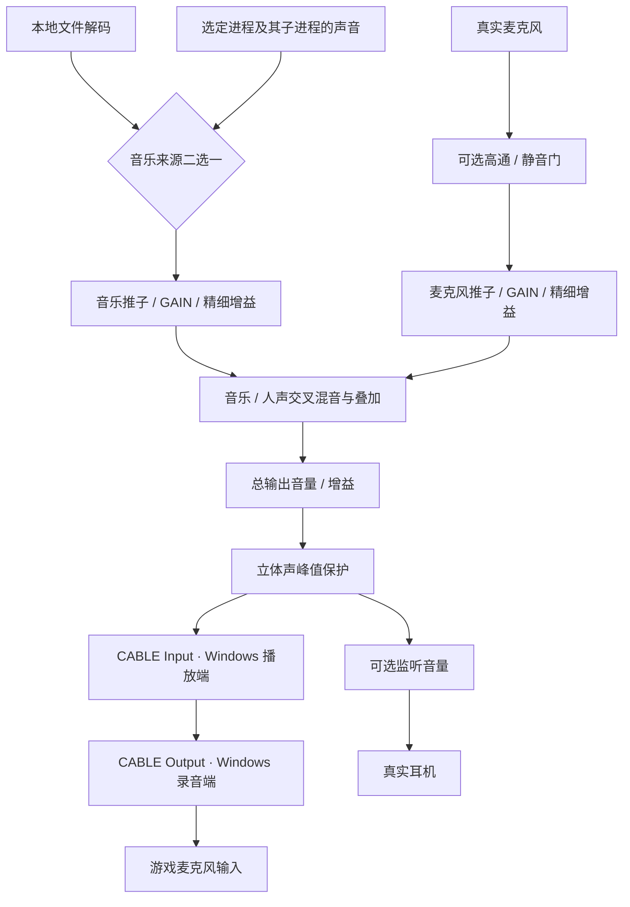

# MicBridge 新手配置说明

**请勿在 Windows 中禁用 CABLE Output，它就是游戏需要选择的虚拟麦克风。CABLE Input 也必须保持启用。** 想暂时不放歌或不传声音，请在音桥中暂停、静音或停止混音，不要关闭这两个系统设备。

音乐来源在“本地”和“进程”之间二选一，再按需叠加原麦克风。以下步骤使用独立虚拟线缆，适合需要在游戏里放音乐的情况。

## 1. 首次安装与重启

1. 下载并双击 `MicBridge.exe`。推荐 Windows 11 x64；程序使用系统 .NET Framework 4.8，运行不需要旁侧 DLL。
2. 若音桥提示缺少虚拟设备，点击“安装虚拟麦克风”。也可以从“高级设置”打开安装入口。已经安装并启用 VB-CABLE 的电脑无需重复安装。
3. 批准 Windows 管理员请求，在 VB-Audio 官方安装器中点击 **Install Driver**，完成后按提示重启电脑，再打开音桥。
4. 若提示设备已安装但被禁用，按下方恢复步骤启用设备，不要再次安装驱动。

完整原始 VB-CABLE Pack45 已内置在 EXE 中，无需另行下载。它是 VB-Audio 的第三方 Donationware，独立于音桥的 MIT 代码许可；可通过[作者官网](https://vb-audio.com/Cable/)捐赠或购买许可。

## 2. 每个位置选什么

| 位置 | 应选择的内容 | 作用 |
|---|---|---|
| 音桥左上“原麦克风” | 真实麦克风、耳麦麦克风或麦克风阵列 | 加入自己的说话声；不要选 CABLE Output |
| 音桥音乐来源“本地” | 电脑里的音乐文件 | 由音桥播放歌曲 |
| 音桥音乐来源“进程” | 正在播放音乐的程序，例如网易云 `cloudmusic` 主进程 | 采集所选进程及其子进程的声音 |
| 音桥右上输出 | **CABLE Input**，普通双声道端口 | 把最终混音送入虚拟线缆 |
| 游戏的麦克风 / 输入设备 | **CABLE Output** | 让游戏接收音桥混音 |
| Windows 默认播放设备 | 真实耳机或扬声器 | 正常收听游戏及其他程序；避免它们直接进入虚拟线缆 |
| 音桥高级设置的可选监听设备 | 真实耳机 | 自己听最终混音，独立调监听音量 |

**CABLE Input 是 Windows 的播放 / 输出设备；CABLE Output 是 Windows 的录音 / 输入设备。** 名称描述的是虚拟线缆：声音从 Input 进入线缆，从 Output 出来供游戏读取。因此，看到名称里有 Output，也不能把它当作无用的扬声器关闭。

游戏单独选择 CABLE Output 即可，不必把 Windows 系统默认麦克风也改成它。普通双声道端口已够用，无需选择名称带 `16ch` 的多通道端口。

## 3. 配好之后开始放歌

1. 先停止混音，再在音桥左上选真实麦克风，右上选 **CABLE Input**。只放音乐时，取消左侧麦克风通道的“启用”；重新勾选即可加入人声。
2. 在游戏声音或语音设置中，将麦克风 / 输入改为 **CABLE Output**。确认游戏的麦克风音量、按键说话或语音激活设置允许发送声音。
3. **本地文件**：音乐来源选“本地”，点击来源按钮选择歌曲，或拖入文件，再点击“播放”。歌曲暂停后，原麦克风仍可继续混入；需要停掉所有转发时，点击“停止混音”。
4. **网易云等程序**：先在该程序中播放歌曲；音桥来源选“进程”，打开来源选择窗口，搜索 `cloudmusic`，优先选择有窗口的网易云主进程，点击“用作声音源”，再点击“启动混音”或“开始采集”。歌曲播放、暂停仍在网易云中操作。
5. 调节左侧人声、中间音乐、右侧总输出三个推子。检查通道已启用、没有静音；高级设置中的音乐 / 人声交叉混音先放在中间，让两路都通过。
6. 使用游戏自带的麦克风测试确认收到混音。软件没有进行过该游戏的专项验证；游戏降噪、自动增益、回声消除和语音门限可能压低或截断音乐，按实际效果调整。

切换本地 / 进程来源或选择新来源，会先停止当前输出，选好后重新启动。播放器退出或重启后，刷新进程列表并重新选择，不能沿用旧 PID。进程列表包含后台和系统进程，但受系统限制的进程可能无法采集。

## 4. 找不到虚拟麦克风时恢复设备

**优先检查 CABLE Output 是否被禁用，同时检查 CABLE Input。禁用设备与卸载驱动是两件不同的事。**

Windows 11：

1. 打开“设置 → 系统 → 声音 → 所有声音设备”。
2. 在输入设备中打开 **CABLE Output**，如果显示不允许使用，点击“允许”。若按钮显示“不允许”，表示它目前已获允许，不要再点该按钮。
3. 在输出设备中检查 **CABLE Input**，同样保持允许使用，确认没有静音或把音量调为零。

Windows 10，或使用经典声音面板：

1. 按 `Win+R`，输入 `mmsys.cpl` 并回车。
2. 在“录制”页的空白处右键，勾选“显示禁用的设备”和“显示断开的设备”。
3. 找到 **CABLE Output**，右键选择“启用”；在“播放”页按相同方法启用 **CABLE Input**。检查设备属性里的音量和静音状态。

恢复后停止音桥混音，在高级设置点击刷新设备，再重新选输出。游戏可能缓存旧设备列表，退出并重新打开游戏，重新选择 **CABLE Output**。重启后仍完全没有这两个端口，才回到安装入口检查官方驱动安装是否完成。

## 5. 声音是怎么进入游戏的

音桥读取本地文件，或者采集所选进程及其子进程，两种音乐来源不同时播放。它将当前音乐与可选的原麦克风统一成 48 kHz 立体声，分别处理音量和增益，再叠加、调总音量并进行峰值保护。最后，VB-CABLE 把音桥写入播放端的声音送到录音端，让游戏当作麦克风接收。

## 6. 音量、监听与回声

- 普通推子范围是 **0–100%**；勾选该路 **GAIN** 后最高 **300%**，表示三倍振幅，不表示主观响度变成三倍。取消 GAIN 时，超过 100% 的位置回落到 100%。高级精细 dB 增益另外叠加，初次使用可保持 0 dB。
- 拾音灯显示实际电平，红灯表示接近数字满刻度；持续红灯或声音变闷时，先降低该路推子或增益。峰值保护避免数字输出过载，但继续加增益不会无限变响，还会压缩动态。
- 建议使用耳机，并关闭 Windows 录音设备的“侦听此设备”。需要听音桥最终混音时，停止混音后在高级设置开启耳机监听，选择真实耳机再启动；监听设备不能与虚拟输出相同。
- 进程模式下，网易云原本就可能直接在耳机中播放。再开音桥监听，会同时听到原声与混音，造成重复或延迟感；不需要监听时保持关闭即可。
- **Windows 默认播放保持真实耳机 / 扬声器。** 若改成 CABLE Input，其他程序会直接进入 CABLE Output，绕过音桥的推子和总静音。音桥会提醒，但不会替你更改默认设备。
- 听到游戏声或回声进入麦克风时，检查是否使用了整个设备采集、声卡立体声混音，或把游戏输出放到了虚拟线缆；这些路径可能再次采到游戏自己的声音。

## 7. 系统与采集模式的限制

| 模式 | 适用情况 | 需要注意 |
|---|---|---|
| 指定进程，含子进程 | 推荐 Windows 11；要求 Windows build 20348 或以上 | 普通 Windows 10 22H2 的 build 19045 不支持；选定进程之外的声音不会由此采集路径混入 |
| 整个播放设备，兼容模式 | 较旧 Windows 或无法使用进程采集时 | 在高级设置选择“整个播放设备（兼容模式）”；会收进所选设备上的全部声音，采集设备必须与音桥输出、监听设备都不同 |
| 声卡立体声混音 | 声卡驱动已有可用录音端点，可省去额外虚拟驱动 | 高级设置启用该模式，游戏选择同一个“立体声混音”；首次播放验证实际可录回输出，不会创建新麦克风 |

声卡模式会录入同一声卡上的其他播放声音，可能包含游戏或音乐程序直出，音桥总静音不能关闭这些外部直出。要隔离它们，需要另一个声卡 / USB 耳机；不能隔离时，使用上面的虚拟线缆配置。不同声卡及耳机 / 扬声器端口的录回能力不同，不能保证所有电脑都支持免额外驱动。

## 8. 设置与权限

音桥启动后不会自动开始采集，需点击播放或启动混音。声音在本机处理，正常混音不保存或上传录音；停止混音和退出会释放音频路由。关闭原麦克风通道的“启用”会释放实际麦克风采集，通道静音则只是不让它传入混音。

设备选择、播放列表、音量等配置保存在 `%LOCALAPPDATA%/MicBridge/settings.json`，错误日志在同目录。配置为 JSON，音桥不主动通过注册表保存设置；不要公开含私人路径的配置或日志。

**驱动安装与音桥设置不同。** 用户主动点击安装入口后，官方安装器才请求管理员批准；安装驱动会注册 Windows 音频设备和相关注册表项，通常需要重启。卸载驱动应使用高级设置中的官方维护入口，并按提示重启；只删除 EXE 不会卸载系统驱动，卸载会影响其他使用 VB-CABLE 的软件。

更多播放列表、降噪相关处理和延迟说明见[完整使用指南](user-guide.md)。
